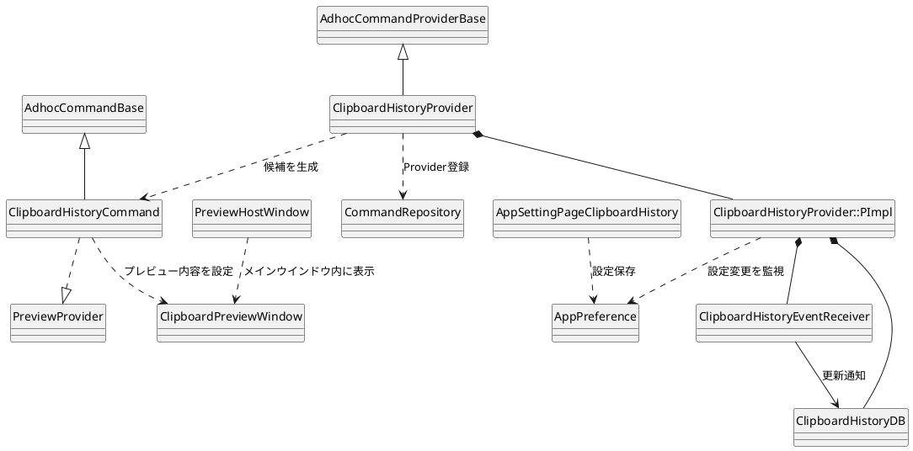

# clipboardhistory

クリップボードのテキスト履歴を記録し、入力内容から履歴を検索して候補として表示するコマンドを実装するディレクトリ。

## 全体構成

`ClipboardHistoryProvider`がAdhoc Command Providerとして登録され、クリップボード更新の受信、履歴の保存、入力パターンに対する候補生成を管理する。各候補は`ClipboardHistoryCommand`で表され、履歴テキストをクリップボードへコピーするアクションとプレビュー表示を提供する。

## 主要クラス

|クラス|役割|
|---|---|
|`ClipboardHistoryProvider`|設定の反映、履歴機能の有効化、Adhoc候補の検索・生成を行う|
|`ClipboardHistoryProvider::PImpl`|設定、履歴データベース、更新レシーバー、検索キャンセル状態を保持する|
|`ClipboardHistoryEventReceiver`|Windowsのクリップボード更新通知を受信し、対象のテキストをリスナーへ通知する|
|`ClipboardHistoryDB`|SQLiteデータベースへの履歴保存と検索を行う|
|`ClipboardHistoryCommand`|1件の履歴候補を表し、コピー操作とプレビュー提供を行う|
|`ClipboardPreviewWindow`|選択中の履歴テキスト、日時、サイズを表示するプレビュー画面|
|`AppSettingPageClipboardHistory`|履歴機能の設定画面を提供する|
|`QueryCancellationToken`|検索処理がキャンセルされたかをデータベースへ伝える|

## 履歴の記録

設定でクリップボード履歴を有効にすると、`ClipboardHistoryEventReceiver`が`AddClipboardFormatListener()`で更新通知を受け取る。Unicodeテキストのみを対象とし、通知間隔を適用する。除外正規表現に合致する内容は記録せず、それ以外を`ClipboardHistoryDB`へ渡す。

データベースはSQLiteを使い、`Path::APPDIRPERMACHINE`配下の`clipboardhistory.db`に保存する。同一テキストはSHA-1をIDとして重複登録を避け、再度コピーされたときは記録日時を更新する。設定された文字列サイズ上限を超えるデータは保存せず、登録件数の上限はデータベースのトリガーで管理する。

## 検索と候補

`ClipboardHistoryProvider::QueryAdhocCommands()`は、設定されたプレフィックスまたは検索開始の最小入力文字数を確認してから履歴を検索する。プレフィックスが指定されている場合は入力先頭の語を取り除き、残りの検索語をデータベースへ渡す。検索結果は一致度を評価して並べ替え、設定件数まで候補を生成する。

候補名はプレフィックスと履歴テキスト、説明は記録日時を表示する。検索結果がない場合は弱い一致の候補が表示されないよう、非表示一致レベルのダミー候補を追加する。

|実行操作|処理|
|---|---|
|修飾キーなしで実行|履歴テキストをクリップボードへコピーする|
|Shift修飾キーで実行|履歴テキストをコピーし、貼り付ける|
|その他の修飾キー|アクションを生成しない|

## プレビュー

`ClipboardHistoryCommand`は`PreviewProvider`を実装する。設定でプレビューが有効な場合、選択中の履歴テキストと記録日時を`ClipboardPreviewWindow`へ設定して返す。プレビュー領域への配置と表示・非表示は`features/main`側が担当する。

プレビュー画面には記録日時、テキスト長、履歴テキストを表示する。タブ文字は表示上4個の空白に置き換える。プレビュー機能は初期状態では無効である。

## 設定

設定画面は「拡張機能 > クリップボード履歴」に登録され、設定は`ClipboardHistoryParam`を通じて`Settings`へ保存・読み込みされる。

|設定キー|初期値|内容|
|---|---:|---|
|`ClipboardHistory:IsEnable`|`false`|履歴機能の有効・無効|
|`ClipboardHistory:Prefix`|`cb`|検索プレフィックス|
|`ClipboardHistory:MinTriggerLength`|`5`|プレフィックス未指定時の検索開始文字数|
|`ClipboardHistory:NumOfResults`|`16`|検索候補の最大件数|
|`ClipboardHistory:SizeLimit`|`4`|履歴として保存するテキストのサイズ上限(KB)|
|`ClipboardHistory:CountLimit`|`1024`|データベースに保持する件数の上限|
|`ClipboardHistory:Interval`|`500`|クリップボード更新を処理する最小間隔(ms)|
|`ClipboardHistory:ExcludePattern`|空文字列|記録対象から除外する正規表現|
|`ClipboardHistory:IsDisableMigemo`|`true`|Migemo検索を無効化する|
|`ClipboardHistory:UsePreview`|`false`|候補選択時のプレビュー表示|

設定の変更時はProviderが設定を読み直す。無効化時はクリップボード監視を停止し、データベースをアンロードしてプレビューを閉じる。

## 関連ファイル

|ファイル|役割|
|-|-|
|`ClipboardHistoryProvider.h/.cpp`|機能の初期化、設定反映、Adhoc候補の検索・生成|
|`ClipboardHistoryParam.h`|設定値の保存と読み込み|
|`ClipboardHistoryEventReceiver.h/.cpp`|クリップボード更新通知の受信と除外条件の適用|
|`ClipboardHistoryEventListener.h`|クリップボード更新リスナーのインターフェース|
|`ClipboardHistoryDB.h/.cpp`|履歴のSQLite保存、重複処理、検索|
|`ClipboardHistoryQueryCancellationToken.h/.cpp`|検索キャンセル状態の管理|
|`ClipboardHistoryCommand.h/.cpp`|履歴候補とコピーアクション、プレビュー提供|
|`ClipboardPreviewWindow.h/.cpp`|クリップボード履歴用プレビュー画面|
|`AppSettingClipboardHistoryPage.h/.cpp`|アプリ設定画面|
